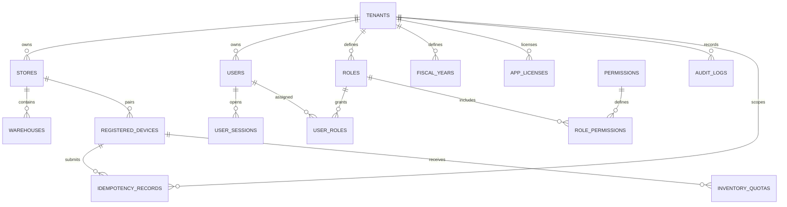
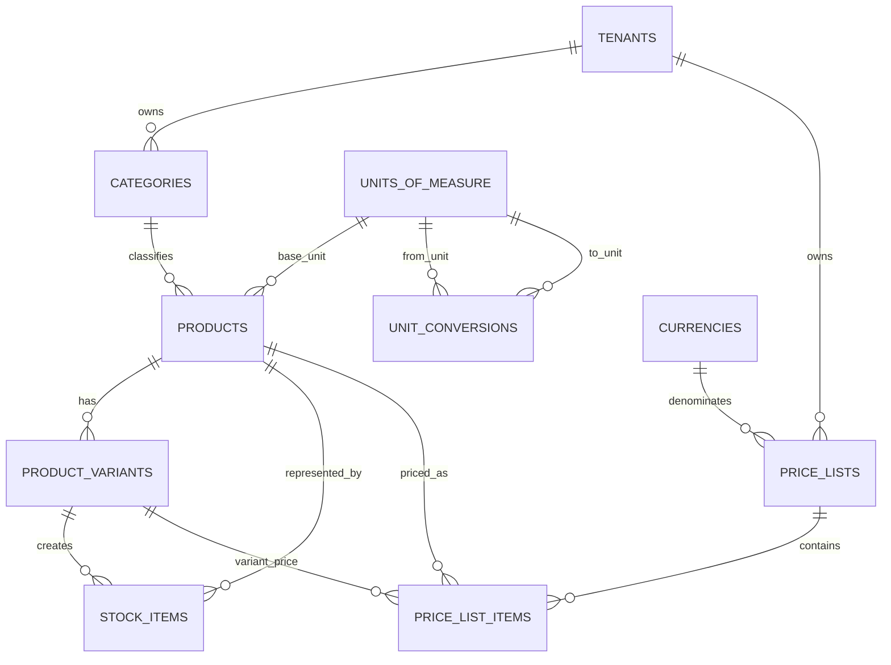
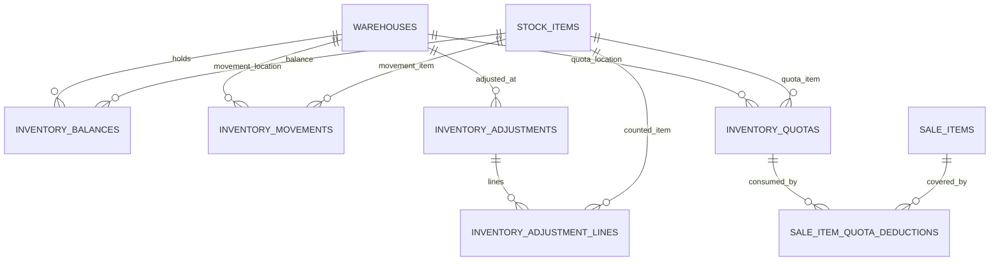
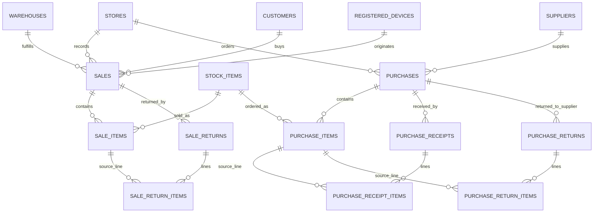
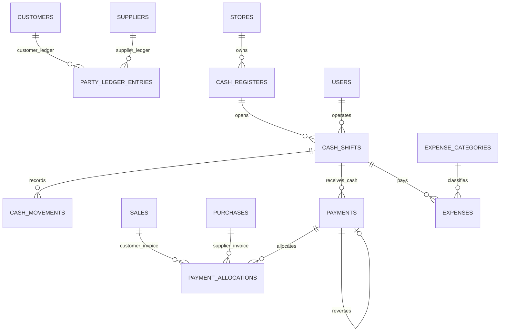

# Store Manager Pro — Entity Relationship Diagrams

**Source of truth:** `canonical_schema.sql` (55 tables). These diagrams are grouped for readability; SQL foreign keys and integrity triggers remain authoritative.

## 1. Tenant, store, identity and devices

## 2. Catalog, variants, units and prices

## 3. Inventory and offline quotas

## 4. Sales, purchases and returns

## 5. Payments, ledger and cash

**Notes:** `party_ledger_entries.party_id` is polymorphic; its Customer/Supplier existence and tenant scope are enforced by triggers. `PAYMENTS` self-reference represents a full reversal link; v1 permits full reversal, not partial reversal. `inventory_balances` is a maintained balance projection fed by immutable `inventory_movements` and quota reservations.
